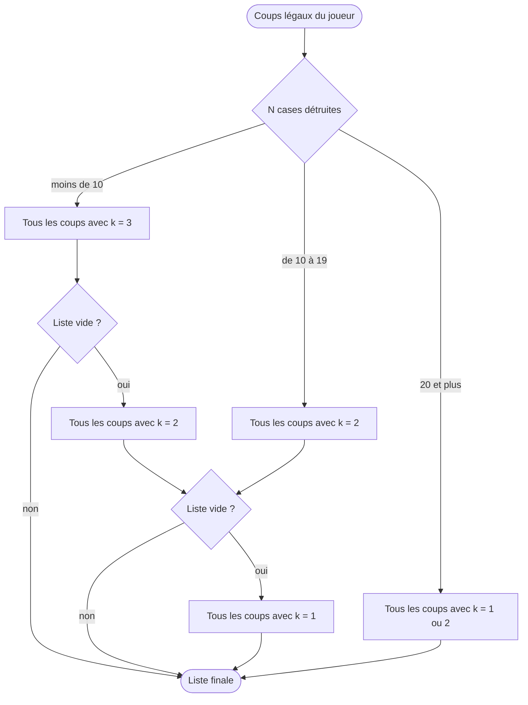

# Isolation 12x12 : règles du serveur officiel

L'énoncé du lab laisse plusieurs points ouverts. Voici comment le serveur officiel les tranche ; `src/rules.rs` implémente exactement ça. Ces règles restent à confirmer par la conformance contre le serveur (`isolation-bot --probe-illegal`, voir le README).

## Plateau et notation

- Colonnes A à L, lignes 1 à 12. Rouge commence en G1, noir en F12. Rouge joue en premier.
- Le plateau des messages `1` et `2` contient 144 entiers, la ligne 12 d'abord, de A à L dans chaque ligne : F12 est l'index 5 et G1 l'index 138.

## Un coup

1. Déplacement de 1 à 3 cases en ligne droite (8 directions). Chaque case traversée et la case d'arrivée doivent être vides : le pion adverse bloque, comme une case détruite.
2. Destruction d'une case située à une distance exacte _k_ du pion adverse, sur l'une des 8 directions (pas l'anneau complet). Rien n'est vérifié entre le pion adverse et la cible.
   - La case de départ du joueur, libérée par son déplacement, peut être détruite.
   - Sa case d'arrivée, non.

## Distance de destruction

Elle dépend du nombre _N_ de cases déjà détruites.

| Cases détruites | Distance _k_ |
| --- | --- |
| moins de 10 | 3 ; s'il n'existe aucun coup à distance 3, alors 2 ; sinon 1 |
| de 10 à 19 | 2, sinon 1 |
| 20 et plus | 1 ou 2 : l'anneau complet de rayon 1 et les 8 cases à distance 2 |

Le repli porte sur l'ensemble des déplacements possibles, pas sur chacun. Dès qu'un seul déplacement permet de détruire à distance 3, seules les destructions à distance 3 sont légales, et un déplacement qui n'en permet aucune (par exemple parce qu'il atterrit sur la seule cible restante) est interdit.

## Fin de partie

- Après chaque coup, si l'adversaire n'a plus aucun coup complet (déplacement et destruction), le joueur qui vient de jouer gagne.
- Pas de partie nulle en Isolation : `DRAW` existe dans le protocole pour d'autres jeux du même serveur.
- Un coup invalide est refusé (`4`) sans arrêter le chrono : un client qui insiste finit en timeout.
