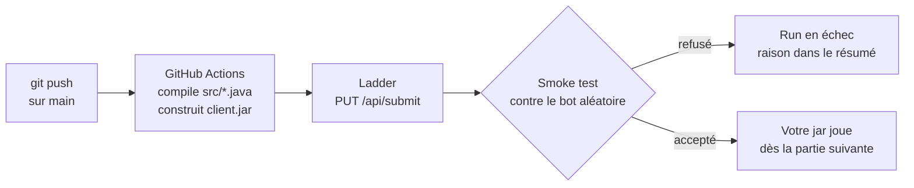

# Soumettre son jar automatiquement

[`ladder.yml`](ladder.yml) est un workflow GitHub Actions pour le dépôt de votre équipe. À chaque push sur `main` qui modifie `src/`, il compile votre client, construit le jar et l'envoie au ladder. Vous n'avez plus rien à faire à la main : votre dernière version joue contre les autres équipes et apparaît au classement.



## Ce qu'il faut

- Le code Java dans `src/`, sans package, avec une classe `Client` qui contient le `main`.
- Le **token** de votre équipe, donné en privé par l'enseignant.
- L'**adresse** de la page du ladder, par exemple `http://ladder.example.org:8080`.

## Installation

1. Copier `ladder.yml` dans le dépôt de l'équipe, sous `.github/workflows/ladder.yml`, puis le committer.
2. Sur GitHub, ouvrir **Settings > Secrets and variables > Actions**.
3. Onglet **Secrets**, bouton **New repository secret** : nom `LADDER_TOKEN`, valeur le token de l'équipe.
4. Onglet **Variables**, bouton **New repository variable** : nom `LADDER_URL`, valeur l'adresse de la page du ladder.

| Nom | Où | Valeur |
| --- | --- | --- |
| `LADDER_TOKEN` | Secrets | token de l'équipe (ne jamais le committer) |
| `LADDER_URL` | Variables | adresse de la page du ladder |

Tant que `LADDER_URL` n'est pas réglée, le workflow est sauté : il peut rester dans le dépôt sans rien casser.

## Soumettre

- **Automatiquement** : pousser sur `main` un commit qui modifie `src/`.
- **À la main** : onglet **Actions**, workflow **Ladder**, bouton **Run workflow**.

Le smoke test joue deux parties et attend la fin de la partie en cours du ladder : un run prend quelques minutes. Le verdict s'affiche dans le **résumé du run** (onglet Actions, cliquer sur le run), avec un lien vers le classement.

## Lire le verdict

| Résumé du run | Sens | Que faire |
| --- | --- | --- |
| `HTTP 200` accepté | Nouvelle version en jeu dès la prochaine partie | Rien |
| `HTTP 200` déjà actif | Ce jar est déjà celui qui joue (même commit relancé) | Rien |
| `HTTP 401` | Token absent ou faux | Vérifier le secret `LADDER_TOKEN` |
| `HTTP 413` | Jar trop gros | Retirer les fichiers inutiles de `src/` |
| `HTTP 422` | Refusé par le smoke test : dépassement de temps, déconnexion, absence ou coup invalide. L'ancienne version continue de jouer | Lire la raison, tester en local (voir plus bas), corriger |
| `HTTP 429` | Soumission trop rapprochée de la précédente | Attendre le délai indiqué, puis **Run workflow** |
| `HTTP 500` | Erreur du ladder | Réessayer plus tard |
| `HTTP 000` | Ladder injoignable | Vérifier `LADDER_URL` ; sinon, soumettre par le formulaire de la page |

Perdre le smoke test n'est pas un refus : seul compte le fait de jouer jusqu'au bout avec des coups valides.

## Tester avant de pousser

Un refus 422 se reproduit en local avec l'arbitre et le bot de la [dernière release](https://github.com/VianAtETS/LOG200-Scoreboard/releases/latest) : voir « Test your bot » dans le [README principal](../README.md#test-your-bot).

## Sans la CI

Le formulaire de la page du ladder fait la même chose, tout comme `curl` :

```sh
curl -T client.jar -H "Authorization: Bearer $LADDER_TOKEN" "$LADDER_URL/api/submit"
```

Détails du protocole de soumission : « Soumission des jars » dans [`docs/formats.md`](../docs/formats.md#soumission-des-jars).
